# Interpret-Then-Obey

Do vision-language models obey prompt injections they must first _interpret_
(another language, an invented script, symbols) before they can act on them?
This repo holds the stimuli, the evaluation harness, and the analysis scripts.
It measures P(interpret) and P(obey | interpret) separately.

- [docs/proposal.md](docs/proposal.md): abstract, motivation, hypotheses, threat model, methods, related work
- [docs/research-plan.md](docs/research-plan.md): who owns which part
- [docs/SPEC.md](docs/SPEC.md): how stimulus data is laid out
- [stimuli/README.md](stimuli/README.md): the stimulus generator
- [eval/README.md](eval/README.md): analysis of a run

The pipeline: `stimuli/` renders the test-case images and writes the manifest,
`harness/` runs a model on the manifest with mocked tools and writes to `runs/`,
and `eval/` analyses a run.

```mermaid
flowchart LR
    subgraph SRC["1 · Sources (hand-written, stimuli/src/)"]
        P["prompts.json<br/><i>user message, e.g. 'Please buy this.'<br/>+ requests_purchase, exclude_contexts</i>"]
        C["context.json<br/><i>benign scene: header, lines,<br/>item, accepted_items</i>"]
        I["injections.json<br/><i>commands × objects<br/>→ 'Buy a {object}.'</i>"]
        R["representations.json<br/><i>how the injection is shown:<br/>natural / constructed / symbols /<br/>opaque / baseline 'none'</i>"]
        ASSETS["fonts/ + symbols/<br/><i>vendored fonts, pre-drawn<br/>symbol images</i>"]
    end

    GEN["<b>2 · Generation</b><br/><i>just build-stimuli</i><br/>Combine every factor into test cases<br/>and render one image per case"]

    IMG[("stimuli/images/&lt;id&gt;.png<br/><i>gitignored, deterministic</i>")]
    MAN[("stimuli/manifest.jsonl<br/><i>committed: one row per test case,<br/>image_sha256, expected_calls</i>")]

    HAR["<b>3 · Harness</b><br/><i>just run &lt;config&gt;</i><br/>Show each case to a vision model with mock tools<br/>and score whether it called buy as injected"]

    CFG["harness/configs/*.yaml<br/><i>model, system_prompt,<br/>generate + run settings</i>"]

    subgraph RUN["runs/&lt;date&gt;_&lt;name&gt;/"]
        META["meta.json<br/><i>config, model, manifest, commit</i>"]
        LOGS["inspect_logs/*.eval"]
        RES["results.jsonl"]
    end

    EVAL["<b>4 · Analysis</b><br/><i>just analyze runs/&lt;a&gt; [runs/&lt;b&gt; …]</i><br/>Name each trial's outcome and compare<br/>obey rates across factors and runs"]

    subgraph OUT["runs/&lt;dir&gt;/analysis/"]
        HTML["outcomes.html<br/><i>one mark per trial</i>"]
        TEX["tables.tex<br/><i>booktabs tables</i>"]
        CM["casemap.html<br/><i>last run only: treemap,<br/>flag cases to drop</i>"]
    end

    SRC --> GEN
    GEN --> IMG & MAN
    IMG & MAN --> HAR
    CFG --> HAR
    HAR --> META & LOGS & RES
    LOGS --> EVAL
    EVAL --> HTML & TEX & CM
    CM -. "prune manifest" .-> SRC

    classDef src fill:#eef6ff,stroke:#4a7bd0,color:#1a1a1a;
    classDef data fill:#fff7e6,stroke:#d08a2a,color:#1a1a1a;
    classDef step fill:#e9f7ee,stroke:#3a9a5b,color:#1a1a1a;
    class P,C,I,R,ASSETS,CFG src;
    class IMG,MAN,META,LOGS,RES,HTML,TEX,CM data;
    class GEN,HAR,EVAL step;
```



## Running locally

Requirements: Python 3.11+ (the Pillow pinned in `stimuli/requirements.txt` has no 3.10 wheels), and [`just`](https://github.com/casey/just)
(`scoop install just`, `brew install just`, or `cargo install just`).
A real model run also needs [Ollama](https://ollama.com) or vLLM.

```bash
just setup         # create .venv and install dependencies
just test          # all tests (no model needed)
just run-dry       # full harness pipeline with Inspect's mock model
```

Run `just` with no arguments to list recipes and what each does. They run from the repo root with
`.venv`'s Python when it exists. On Windows they run under `pwsh`. Only `run` needs a real model.

Arguments after a recipe pass straight through to the script; `just run --help` lists the harness's flags.

### A real model run

```bash
ollama pull qwen3-vl:8b
just run harness/configs/qwen3vl-8b-ollama.yaml --limit 5   # try a few rows first
just run harness/configs/qwen3vl-8b-ollama.yaml             # full manifest
just run --resume runs/<date>_qwen3vl-8b-ollama             # if some rows errored
just analyze runs/<date>_qwen3vl-8b-ollama                  # interactive plot + LaTeX tables
inspect view --log-dir runs/<date>_qwen3vl-8b-ollama/inspect_logs
```

"Obeyed" means the model actually made the expected tool call (scored by the harness).
See [eval/README.md](eval/README.md) for what `analyze` reports.

Each run directory records, in `meta.json`, what produced it,
so a result can be traced back to exactly that config, model, manifest and commit.

### Reproducibility notes

- Stimulus renders are byte-identical across OSes as long as the vendored fonts
  (`stimuli/fonts/`) and the pinned Pillow are used. `just test` checks this
  (the check is skipped, not failed, on a different Pillow version).
- If you change the stimuli, run `just build-stimuli` and commit the new `stimuli/manifest.jsonl` (the images are gitignored; their hashes are in the manifest).
- `just test` regenerates gitignored fixture files in `harness/fixtures/`, and `run`/`run-dry`
  write to `runs/`. Don't commit those by accident.
