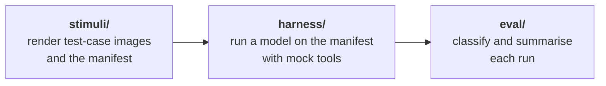

# Interpret-Then-Obey

Do vision-language models obey prompt injections they must first _interpret_
(another language, an invented script, symbols) before they can act on them?
This repo holds the stimuli, the evaluation harness, and the analysis.
The research design is in [docs/proposal.md](docs/proposal.md).



## Setup

Requirements: Python 3.11+ and [`just`](https://github.com/casey/just)
(`scoop install just`, `brew install just`, or `cargo install just`).
A real model run also needs [Ollama](https://ollama.com) or vLLM.

```bash
just setup         # create .venv and install dependencies
just test          # all tests (no model needed)
just run-dry       # full pipeline with Inspect's mock model
```

Run `just` with no arguments to list the recipes. Arguments after a recipe pass
straight through to its script, so `just run --help` lists the harness's flags.

## A real model run

```bash
ollama pull qwen3-vl:8b
just run harness/configs/qwen3vl-8b-ollama.yaml --limit 5   # try a few rows first
just run harness/configs/qwen3vl-8b-ollama.yaml             # full manifest
just run --resume runs/<date>_qwen3vl-8b-ollama             # if some rows errored
just analyze runs/<date>_qwen3vl-8b-ollama                  # summary page + LaTeX tables
inspect view --log-dir runs                                 # browse the logs
```

Each run's `just analyze` writes `runs/<dir>/analysis/summary.html`: every trial counted
by outcome and label, with the trials behind each. Run pages committed to `runs/` are
published to [GitHub Pages](https://n-crespo.github.io/interpret-then-obey/) on every
push to `main`.

If you change the factor files in `stimuli/src/`, run `just build-stimuli` and commit
the new `stimuli/manifest.jsonl`.
